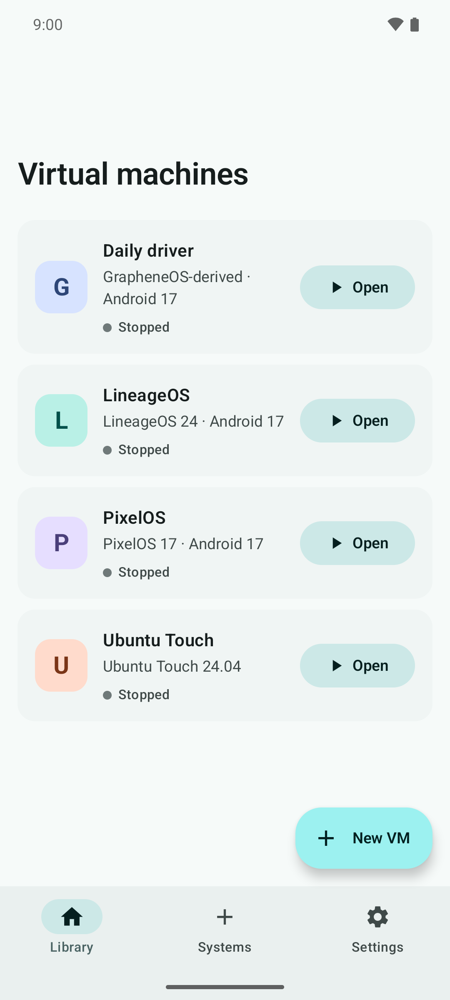
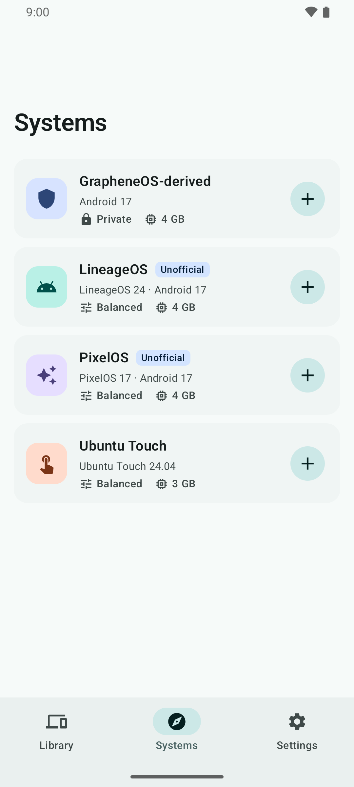
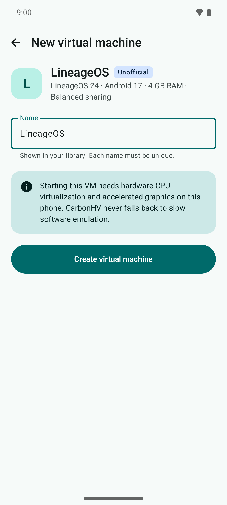
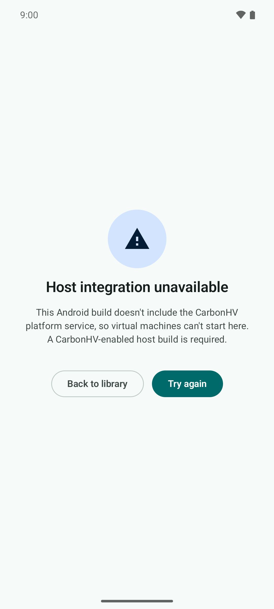
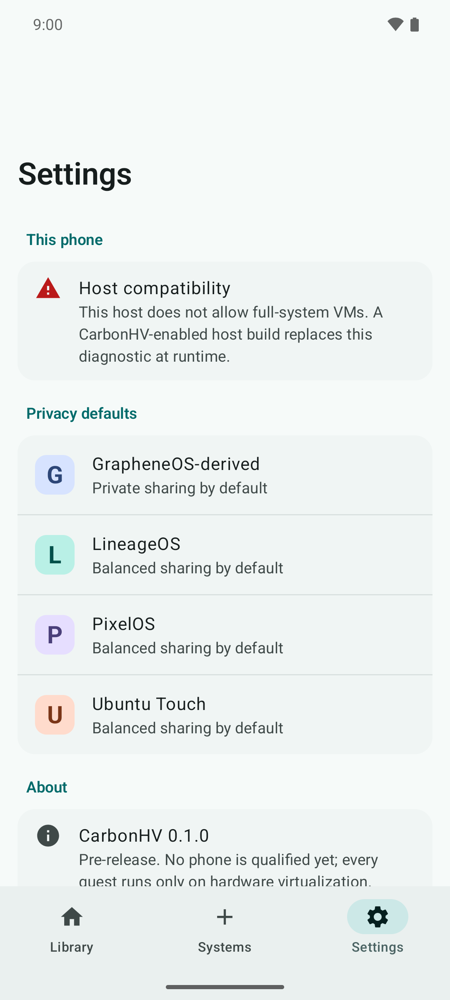
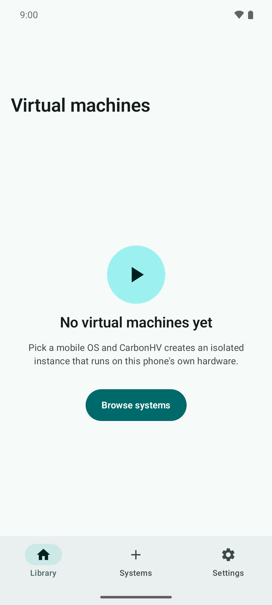
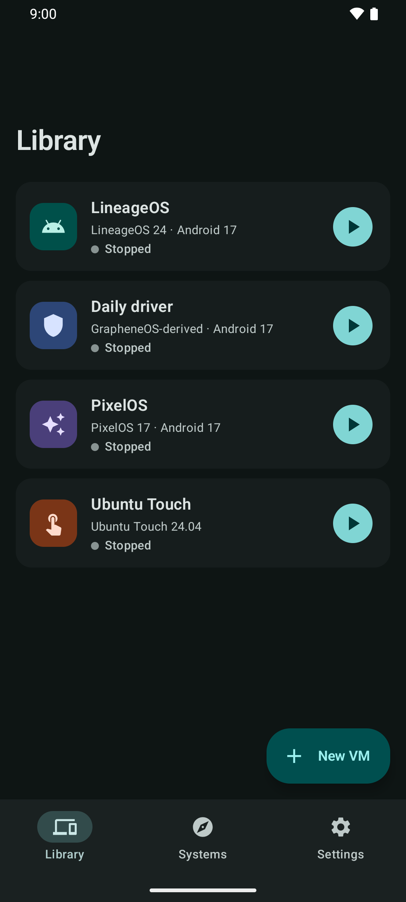
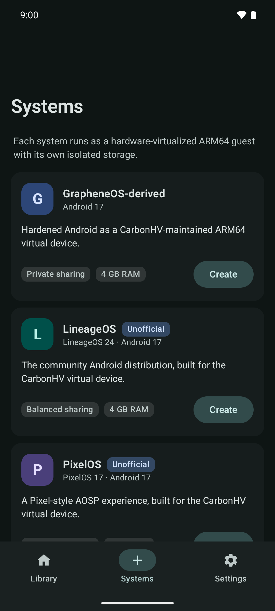
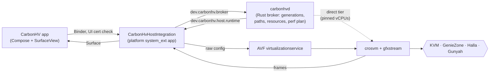

# CarbonHV

[](https://github.com/itsrhotaudevvy/CarbonHV/actions/workflows/ci.yml)
[](https://github.com/itsrhotaudevvy/CarbonHV/releases)
[](LICENSE)

**CarbonHV is an Android-native virtual-machine manager that runs full mobile operating systems as hardware-virtualized ARM64 guests on your phone.** It has a native Kotlin/Jetpack Compose manager, an immersive guest session drawn straight into an Android `SurfaceView`, and a narrow Rust broker that owns every VM.

The first two guests are:

- a **CarbonHV-maintained GrapheneOS-derived** ARM64 virtual-device build (Android 17 line). It is not an official GrapheneOS target or release;
- **Ubuntu Touch with Lomiri** (24.04 series), adapted as a real mobile Linux guest rather than a generic desktop.

Additional Android-derived ROMs are being ported on the same CVD1 overlay ([ADR-016](docs/ARCHITECTURE.md)):

- **LineageOS**, unofficial: `lineage-24.0` (Android 17) by default, or `lineage-23.2` (Android 16);
- **PixelOS**, unofficial: `seventeen` (Android 17) by default, or `sixteen-qpr2` (PixelOS 16.2).

Both are recipe-only today ([`guest/lineageos`](guest/lineageos), [`guest/pixelos`](guest/pixelos)).

> [!IMPORTANT]
> **Pre-release.** CarbonHV is a development milestone, not a supported release. The source, contracts and tooling are verified in CI. **No guest has yet booted on a physical phone through CarbonHV**, and every physical host is `EXPERIMENTAL` or `UNSUPPORTED`. See the [support matrix](docs/SUPPORT_MATRIX.md) for exactly what is proven and what is still hardware-gated. CarbonHV never falls back to software CPU emulation. Phones whose hypervisor is unreachable from apps may run a guest in an explicitly chosen **Emulated** engine instead (see below).

## Screenshots

Captured from the debug APK on an Android 16 (API 36) arm64 emulator. A stock build has no CarbonHV host integration, so opening a VM fails closed as designed.

| Library | Systems | New VM | Stock phone |
| :---: | :---: | :---: | :---: |
|  |  |  |  |
| **Settings** | **Empty library** | **Dark library** | **Dark systems** |
|  |  |  |  |

## Phones and SoCs

One broker policy, one guest ABI (CVD1: `virtio-gpu`, `virtio-blk`, `virtio-input`, `virtio-net`, `virtio-snd`, vsock) and one gfxstream graphics transport cover every family. Vendor differences are probe facts and a renderer profile, never a guest fork ([ADR-015](docs/ARCHITECTURE.md)).

| Family | Hypervisor | Host GPU profile | Status |
| --- | --- | --- | --- |
| Google Tensor G1–G4 | KVM/pKVM | Mali | Pixel 7a probed: `EXPERIMENTAL` (AVF + `/dev/kvm` present) |
| Google Tensor G5 | KVM/pKVM | PowerVR | source + fixtures |
| Samsung Exynos | Halla (needs a vendor crosvm) | Xclipse / Mali | source + fixtures |
| MediaTek Dimensity | GenieZone | Immortalis / Mali | source + fixtures |
| Qualcomm Snapdragon | Gunyah | Adreno | Snapdragon 6 Gen 3 probed: `UNSUPPORTED` on stock firmware; controlled-build path in source ([ADR-013](docs/ARCHITECTURE.md)) |

### No hardware virtualization on your phone?

On stock phones where Android denies apps every hypervisor device (the probed Redmi `kunzite` is one), CarbonHV can run a guest in **Emulated** mode: QEMU's dynamic binary translation for guest CPU instructions, with **GPU-accelerated graphics** through gfxstream on the phone's own GPU.

- It is **opt-in per instance** and shown as *Emulated* everywhere. It is never selected automatically, and a hardware-VM instance never silently becomes emulated.
- CPU-bound work is **much slower than native**; graphics stays hardware-accelerated. Performance numbers are not claimed until they are measured on hardware.
- It shares the CVD1 guest ABI with the hardware path, so the same guest image and disks work on both.

The planning code (`crates/carbon-emu`) and the QEMU build recipe (`emu/qemu/`) are verified in source and CI; **no emulated guest has booted on a phone yet**, and the engine stays `EXPERIMENTAL`. See the support matrix (§2d) for exactly what is and is not proven.

### Near-native performance

The broker plans each session from the measured host topology ([§24.3](docs/ARCHITECTURE.md)):

- **CPU placement:** vCPUs are pinned 1:1 to performance cores, and in-order efficiency cores are excluded by `MIDR_EL1`. The guest sees the real capacities and frequency domains.
- **Frequency:** guest DVFS reaches the host through crosvm's virtual cpufreq device.
- **Memory:** transparent huge pages are advised, and free pages are reported back to Android.
- **I/O and graphics:** unprotected VMs share memory directly, so there are no bounce buffers.

None of this trades away isolation.

## Architecture



The app never sees host paths, executables or kernel parameters. `carbonhvd` is the only authority for VM generations and launch plans, and SELinux pins every Binder edge. See [Architecture](docs/ARCHITECTURE.md) and [Security](docs/SECURITY.md).

## Quick start

You need Rust 1.90+, JDK 17, Android SDK 36 (build-tools, CMake 3.22.1, NDK), and Python 3.11+.

```bash
export JAVA_HOME="$(brew --prefix openjdk@17)/libexec/openjdk.jdk/Contents/Home"   # macOS
export GRADLE_USER_HOME="$PWD/.gradle-local"
scripts/verify.sh            # the same gate CI runs
cargo build --release        # target/release/carbonctl, target/release/carbonhvd
```

`scripts/verify.sh` runs:

- formatting and the Rust test suite;
- validation of both starter manifests and both CVD1 guest contracts;
- the guest kernel-config fragments;
- shell, SELinux and Soong contracts;
- the qualification and GPU fixtures;
- the Android JVM tests and the debug APK build.

### Probe your phone (read-only)

```bash
adb devices -l
qualification/carbon-qualify.sh --adb <serial>
```

The probe reports:

- the hypervisor (KVM, GenieZone, Halla or Gunyah) and the AVF VM-support properties;
- the vendor device's SELinux label, CPU core types and frequency domains;
- the GPU and its renderer profile.

Results from new phones are very welcome: open a [host probe report](https://github.com/itsrhotaudevvy/CarbonHV/issues/new?template=host_probe.yml).

### Check a guest kernel

```bash
carbonctl guest kernel-config ubuntu-touch path/to/.config
```

It exits 3 for a CVD1 contract gap and 5 for a near-native performance gap. The shared fragment is [`guest/common/kernel/cvd1-near-native.fragment`](guest/common/kernel/cvd1-near-native.fragment).

## What's verified vs. still gated

**Verified in source and CI:**

- Rust admission, lifecycle, storage, update, backup and clone transactions;
- strict ARM64/CVD1 bundle and guest-contract validation;
- the authenticated broker with generation and replay checks, resource caps and managed object IDs;
- AVF launch plans and Android 17 raw-config publication over Binder;
- direct crosvm launch plans for all four phone hypervisors;
- the near-native performance plan;
- the Compose manager and immersive session shell;
- GPU capability and renderer profiles for five GPU families;
- the emulated engine's QEMU argv, memory admission, bootconfig assembly and frame protocol (golden-tested);
- fail-closed qualification tooling.

**Still hardware or integration gated:**

- a controlled Android 17 host build with CarbonHV's platform integration installed;
- a guest booted through CarbonHV's AVF or direct path, and gfxstream frames presented in the CarbonHV surface;
- real GrapheneOS-derived and Ubuntu Touch images;
- `carbonhvd` spawning and supervising the direct crosvm tier;
- calibrated performance and thermal thresholds;
- signed release bundles.

## Repository map

| Path | Responsibility |
| --- | --- |
| `crates/carbon-core` | Admission, bundle/CVD contracts, guest kernel config, lifecycle, storage, update, backup, clone semantics, GPU profiles |
| `crates/carbon-protocol` | Typed broker-facing protocol data |
| `crates/carbon-broker` | `carbonhvd`: broker policy, host topology and performance plan, AVF and direct-crosvm launch planning, Binder services |
| `crates/carbon-renderer` | Renderer backend profiles (crosvm/Rutabaga/gfxstream) |
| `crates/carbon-cli` | `carbonctl` validation and diagnostic CLI |
| `crates/carbon-emu` | Emulated-engine planning: QEMU argv, TCG placement, memory admission, CPU model, boot-image/bootconfig assembly, QMP, frame protocol |
| `android/domain` | Android-facing immutable domain models and reducers |
| `android/app` | Native Compose manager and immersive session surface |
| `android/host-contract` | JVM tests for the platform host-integration logic |
| `host` | Platform host integration, AIDL, SELinux, Soong and product fragment |
| `bundles` | Starter bundle manifests and schema notes |
| `guest/android`, `guest/ubuntu-touch`, `guest/common` | Starter guest recipes, CVD1 contracts, kernel fragments |
| `guest/aosp-overlay`, `guest/lineageos`, `guest/pixelos` | Shared CVD1 product overlay and recipes for AOSP-derived custom ROMs |
| `emu/qemu` | Pinned QEMU/glib/gfxstream cross-build recipe for aarch64 Android (no binaries committed) |
| `qualification` | Physical-host probe, GPU qualification policy, emulated-engine fixtures and evidence reports |
| `docs` | Architecture, building, security, support matrix, plans |

## Documentation

- [Architecture](docs/ARCHITECTURE.md): product and system architecture, including ADRs
- [Building and verification](docs/BUILDING.md)
- [Guest image builds in CI](docs/GUEST_BUILDS.md): one repository per guest, what each can
  actually build today, and why the recipes stay in this tree
- [Security model](docs/SECURITY.md) and [security policy](SECURITY.md)
- [Support matrix](docs/SUPPORT_MATRIX.md): what is verified, observed, partial or gated
- [Controlled host product integration](host/product/README.md), including Snapdragon (Gunyah) hosts
- [Changelog](CHANGELOG.md)

## Contributing

Read [CONTRIBUTING.md](CONTRIBUTING.md). The project's one non-negotiable rule is to **never claim more than the evidence shows**. Conduct is covered by the [code of conduct](CODE_OF_CONDUCT.md). Please report vulnerabilities privately ([SECURITY.md](SECURITY.md)).

## License

Apache-2.0 ([LICENSE](LICENSE), [NOTICE](NOTICE)). The upstream guest operating systems, Android components and Linux components keep their own licenses. CarbonHV is not affiliated with Google, GrapheneOS, UBports, Samsung, MediaTek or Qualcomm.
