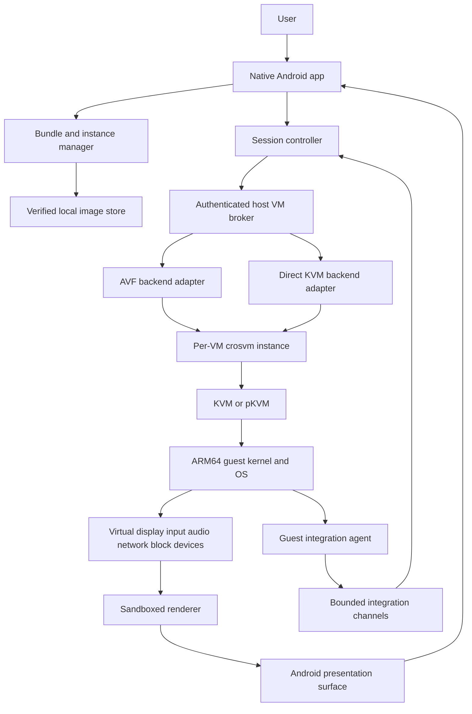
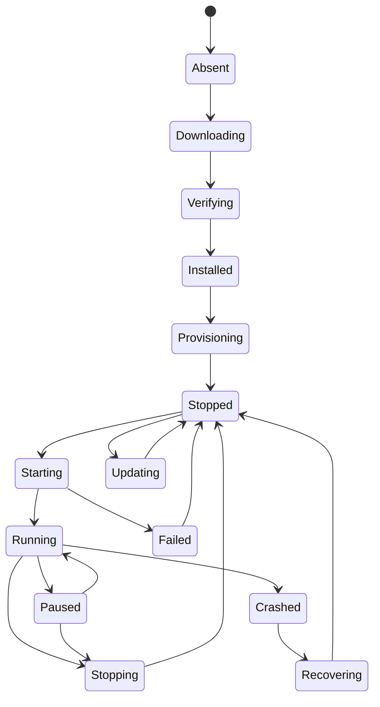
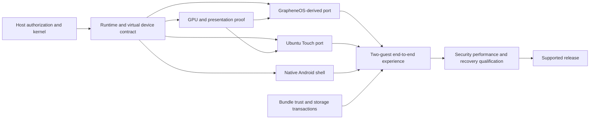

# CarbonHV — Native Android Virtual Machines

**Document type:** architecture and delivery roadmap; no implementation code.  
**Status:** proposed design, with explicit feasibility gates.  
**Prepared:** 2026-09-27.  
**Initial guests:** GrapheneOS-derived ARM64 virtual-device build and Ubuntu Touch ARM64 virtual-device port.  
**Primary host:** a qualified ARM64 Android device with an authorized hardware virtualization backend.  
**Product promise:** enter another mobile operating system locally, with responsive touch, accelerated graphics, and a coherent native Android experience.

## 1. Intent and scope

CarbonHV is an Android application for creating, managing, and entering complete virtual machines that run related mobile operating systems. Each guest has its own kernel, system image, writable data, identity, and lifecycle. A user should be able to install a curated bundle, finish the guest's own onboarding, and use its actual applications and shell in an immersive full-screen session.

“Same family as Android” means two related categories: Android-derived operating systems such as GrapheneOS, and Linux-based mobile operating systems such as Ubuntu Touch. Ubuntu Touch is not an Android distribution; common Linux ancestry and the mobile use case justify its inclusion. Compatibility comes from an explicit virtual hardware platform, not from assuming that Linux-based operating systems have interchangeable images.

The experience has three independently required kinds of native behavior:

1. **Native host application:** Kotlin, Android platform integration, Compose controls, platform accessibility, real surfaces, and normal Android lifecycle behavior.
2. **Native guest execution:** same-architecture ARM64 CPU execution through hardware virtualization; no instruction translation in the supported production path.
3. **Native-feeling interaction:** guest GPU work accelerated by the host GPU where qualified, direct local presentation, predictable touch and keyboard behavior, audio, rotation, and useful host integration.

Passing only the second requirement is insufficient. A hardware-accelerated CPU with software-rendered graphics and remote-desktop latency does not meet the product goal.

### 1.1 Assumptions chosen for this proposal

- Phone-first personal use, with tablets and foldables designed in from the beginning.
- Local execution and offline use after bundle installation; no account or cloud VM requirement.
- One foreground VM in the first release; multiple installed VMs are supported.
- Device-specific host integration is acceptable to achieve the requested experience.
- The first release may require a supported host OS integration; universal installation on stock phones is not promised.
- A supported host should ultimately retain verified boot and enforcing SELinux, without requiring everyday root access.
- The project maintains guest ports when upstream projects do not publish compatible images.
- No product code, dependency setup, image builds, device modifications, or deployment is part of this document's creation.

### 1.2 Initial exclusions

Cross-ISA emulation, cloud streaming, shared-kernel containers, nested virtualization, baseband access, physical GPU assignment, arbitrary phone factory-image import, unrestricted USB passthrough, and seamless individual guest-app windows are outside the initial release.

These exclusions keep the initial architecture focused on a complete, polished mobile VM. A later extension must preserve the same isolation and capability model.

## 2. Feasibility facts and evidence boundaries

The following facts shape the proposal. References are collected in section 35. Everything described as a CarbonHV contract, target, budget, policy, or phase below is a proposed engineering decision, not a claim that an existing upstream system already implements it.

| Finding | Consequence | Evidence |
| --- | --- | --- |
| AVF includes an Android virtualization architecture using crosvm and KVM/pKVM | Prefer the platform backend over inventing a hypervisor | [S1], [S2] |
| AOSP documents custom VM launch on a rooted AVF-enabled device | A developer launch path is not proof that an ordinary installed APK can launch arbitrary guests | [S3] |
| AOSP's custom-VM documentation also describes a Terminal GUI/acceleration setup | Existing platform work is useful evidence, but is not a stable third-party graphics contract | [S3] |
| GrapheneOS documents an x86_64 SDK emulator development target, with security limitations | That target is not a ready-made native ARM64 phone VM bundle | [S4] |
| GrapheneOS production support is device-specific | A downstream VM port must identify its maintainer and cannot inherit supported-device security claims | [S5] |
| Ubuntu Touch's documented Android-device ports combine a rootfs, Halium, and device support | A phone image is not a generic virtio VM image; a separate port is necessary | [S6] |
| gfxstream and Mesa Venus provide relevant graphics virtualization components | Evaluate real guest/renderer/driver combinations; component existence does not establish Android-host compatibility | [S7], [S8] |
| Android immersive mode still allows system navigation behavior | Immersion must coexist with host escape and system UI | [S9] |
| Android foreground services have type and lifecycle restrictions | Long-running VM ownership needs an explicit host integration design | [S10] |

### 2.1 What cannot be inferred

- An ARM64 CPU does not establish usable EL2, a usable KVM configuration, or permission to access it.
- Root does not create a missing hypervisor, expose firmware-withheld EL2, or guarantee a compatible GPU stack.
- AVF being present does not establish authorization for arbitrary full-system guests or all virtual devices.
- A working Microdroid workload does not demonstrate a full Android or Ubuntu Touch desktop.
- A GPU-rendered Android activity does not prove that the guest is GPU accelerated.
- A protected VM does not automatically have a confidential display, input path, audio path, or shared file interface.
- A successful Linux desktop demo does not establish Ubuntu Touch session, update, confinement, and device-service compatibility.
- A source build based on GrapheneOS is not automatically an official GrapheneOS release.

### 2.2 Evidence policy

Record the exact host firmware, kernel, AVF/APEX revision, backend build, guest build, GPU driver, renderer, and device model for every qualification. Pin source commits when implementation begins. Moving documentation and development branches are discovery references, not release specifications.

A benchmark, video, or upstream demo can justify an experiment. Only reproducible tests on the intended Android host can qualify a product configuration.

## 3. Architectural approaches considered

| Approach | Strengths | Limitations | Decision |
| --- | --- | --- | --- |
| AVF-backed platform integration | Aligns with Android virtualization architecture; platform lifecycle and security integration | Privileged interfaces and virtual-device support vary by host release | Preferred production direction |
| Narrow host broker with direct KVM/crosvm | More control over guest devices and renderer experiments | Requires kernel support, policy work, packaging, and a larger maintenance burden | Supported development path; possible qualified host-specific backend |
| Ordinary APK using software CPU emulation or remote desktop | Broader installability and easier prototypes | Fails the native execution or local interaction goals | Excluded from the product path |

**Recommendation:** one native Android product, one stable CarbonHV broker contract, and replaceable backend adapters. Start on a controlled host build. Prefer AVF where its concrete release supports the required guest and graphics contracts; use direct KVM for bounded bring-up work or explicitly qualified configurations.

Do not maintain two equal production stacks initially. Gate 1 selects the first production adapter. The second adapter remains a capability boundary and development tool until there is a funded support case.

## 4. Host support and distribution strategy

### 4.1 Host tiers

| Tier | Configuration | Product behavior |
| --- | --- | --- |
| H0: unsupported | No usable hardware virtualization or no authorized backend | Native library/catalog UI and clear explanation; VM creation/launch blocked |
| H1: development | Rooted or engineering host with proven KVM/AVF access | Experimental sessions; prominent qualification status; local diagnostics |
| H2: integrated | Signed host service, explicit policies, qualified kernel/AVF and renderer | Initial production target |
| H3: ordinary-app capable | Future or existing host release exposing sufficient authorized interfaces to installed apps | Enable only after the same qualification suite passes; no assumption of availability |

An H2 integration is more than installing a privileged APK. It includes the appropriate API permission checks, service ownership, SELinux domains, renderer access, image storage policy, and compatibility across host updates. Platform signature, allowlisting, and service permissions must be audited against the selected host branch.

### 4.2 Reference device selection

Choose the first physical device after measurement, using these criteria:

- ARM64 hardware virtualization accessible through the selected backend.
- Maintained kernel and firmware, usable development images, and recovery documentation.
- At least 12 GiB RAM preferred for bring-up; 8 GiB considered only after measurement.
- Adequate internal storage for two guest installations, updates, and recovery copies.
- GPU driver and renderer combination that passes the proposed accelerated display tests.
- A realistic path to an integrated, signed production host configuration.
- Repeatable access to at least two units for regression and recovery testing.

A Pixel-class device with AVF is a candidate, not an automatically certified choice. A different device may be the better graphics research platform. Certification applies to a device-plus-host-build tuple.

### 4.3 Packaging

Distribute the native UI APK separately from the host integration package and guest bundles. The APK can describe missing integration, but cannot self-grant system privileges. Host integration installation follows the host OS's documented installation and update mechanism.

Initial distribution should use a signed project release channel appropriate to the supported host. App-store distribution is a later review item; this design does not assert that privileged integration or downloaded guest payloads satisfy any particular store's rules.

## 5. System decomposition

The two backend paths are alternatives, not two stacked hypervisors. AVF may own crosvm and its sandbox; CarbonHV must not duplicate ownership where the platform already provides it.

### 5.1 Ownership table

| Component | Owns | Must not own |
| --- | --- | --- |
| Android UI | Navigation, consent, host surfaces, accessibility, user-visible state | Hypervisor access, arbitrary privileged execution |
| Instance manager | Configuration, bundle references, quotas, lifecycle requests | Direct block writes into a running guest |
| Host broker | Authorization, validated VM specification, resource grants, backend lifetime | Generic root shell, arbitrary path access |
| Backend adapter | Translation into a qualified host virtualization interface | Product UX or guest branding decisions |
| VMM | vCPU execution and declared virtual devices | User consent policy |
| Renderer process | Graphics command decoding, GPU resources, scanout production | General storage access, network credentials |
| Guest agent | Guest readiness and narrow integration features | Deciding host permissions |
| Bundle pipeline | Reproducible artifacts, signatures, provenance, update compatibility | Runtime access to users' VMs |

## 6. Technology and module boundaries

Use Kotlin and Jetpack Compose for the host shell, platform APIs for system integration, and a SurfaceView-backed session presentation path. Keep continuously changing frames out of Compose's state/recomposition path.

Use Rust for new privileged control, manifest validation, protocol parsing, and backend glue where the platform permits it. Reuse crosvm rather than writing a hypervisor or a complete VMM. Existing C/C++ graphics libraries remain isolated behind narrow native boundaries. Use Binder/AIDL for authenticated local Android control and vsock for supported host/guest control channels.

These choices do not make dependencies automatically memory-safe. Renderer decoders and native libraries remain significant attack surfaces.

### 6.1 Proposed repository responsibilities

| Future area | Responsibility |
| --- | --- |
| `app/` | Native application entry, navigation, dependency composition |
| `features/library/` | Installed systems and instance actions |
| `features/catalog/` | Bundle discovery, compatibility, installation |
| `features/session/` | Immersive VM screen and controls |
| `features/settings/` | Host preferences, per-instance grants, diagnostics |
| `core/model/` | Product states and immutable domain contracts |
| `core/bundles/` | Metadata verification and installation transactions |
| `core/storage/` | Image references, quotas, exports, recovery |
| `core/runtime/` | Session coordination and lifecycle reconciliation |
| `core/bridge/` | Versioned host/guest integration contract |
| `native/broker/` | Narrow authenticated host service |
| `native/backend-avf/` | Selected platform integration |
| `native/backend-kvm/` | Explicitly qualified direct backend |
| `native/graphics/` | Presentation and renderer boundary |
| `guest/common/` | Shared protocol definitions and portability contracts |
| `guest/android/` | Android virtual hardware and integration adaptations |
| `guest/ubuntu-touch/` | Ubuntu Touch device/session adaptations |
| `bundles/` | Declarative recipes and release metadata |
| `host/` | Host policy, packaging, qualification profiles |
| `qualification/` | Device, guest, performance, and recovery specifications |
| `docs/` | Architecture, decisions, threat model, support contracts |

This is a responsibility map, not a request to scaffold these directories now. Avoid introducing an abstraction for every library; stabilize only boundaries that cross trust, release, or ownership domains.

## 7. Capability discovery and admission

Capability discovery returns evidence-backed properties, not one `supported` boolean.

| Capability group | Required evidence |
| --- | --- |
| CPU | Host ISA, usable virtualization backend, supported vCPU features |
| Authorization | Calling app identity, broker permission, permitted VM classes |
| Guest boot | ARM64 kernel and firmware formats accepted by this adapter |
| Isolation | Non-protected/protected modes actually available |
| Display | Scanout, formats, maximum size, rotation and resize behavior |
| GPU | Guest API features, renderer, actual hardware driver, sharing method |
| Input | Touch slots, keyboard, mouse, stylus support |
| Audio | Output/input formats and backend availability |
| Storage | Capacity, allocation method, flush semantics, encryption policy |
| Network | Offline, outbound-only, IPv4/IPv6 policy enforcement |
| Lifecycle | Shutdown, live pause, durable checkpoint, background ownership |
| Platform | Host revision, page size, native ABI alignment, SELinux state |

Discovery is layered: cheap static checks, broker authorization, a bounded diagnostic VM if needed, and a persisted qualification record. Running diagnostics must not require installing a multi-gigabyte guest first.

Admission intersects host capabilities, bundle requirements, per-instance configuration, available resources, and the current qualification policy. Unknown required capabilities fail closed. Optional capabilities remain visibly unavailable rather than silently emulated.

The user sees concrete states such as “Ready for accelerated sessions,” “CPU acceleration available; graphics experimental,” or “This host does not allow full-system VMs.” Technical details belong in an expandable diagnostics view.

Re-run relevant checks after a host update, renderer update, broker update, or device policy change. A previously qualified model name alone must never bypass admission.

## 8. Virtual hardware platform

Define a versioned **Carbon Virtual Device** contract. Bundles target this contract rather than impersonating a physical phone. Keep an adapter-specific realization because AVF and direct KVM may expose different boot and transport details.

| Device | Initial contract | Guest obligations |
| --- | --- | --- |
| CPU | ARM64, bounded vCPU count, explicit feature set | Compatible kernel and userspace; no assumed ARM32 execution |
| Interrupts/timers | Backend-qualified GIC and architectural timer model | Correct SMP, timekeeping, shutdown, suspend behavior |
| Firmware/boot | Pinned adapter-specific verified boot chain | Declared kernel, ramdisk, boot metadata, partition layout |
| Block | virtio block or qualified equivalent | Flush/discard semantics and recovery-capable filesystems |
| Display/GPU | virtio-gpu family with a pinned renderer protocol | Matching guest graphics drivers and display integration |
| Input | virtio input where supported | Multi-touch, key, pointer and device capability handling |
| Audio | Qualified virtual sound device or bounded PCM bridge | Guest audio HAL/backend appropriate to the OS |
| Network | Virtual Ethernet, stable per-instance identity | Normal network configuration; no fake physical radio |
| Entropy | Virtual entropy source backed by host CSPRNG | Unique first boot identity generation |
| Guest control | vsock when exposed by the backend | Versioned agent handshake and bounded messages |
| Power | Virtual battery/power state and shutdown channel | Mobile-shell integration and sensible idle behavior |

The first guest profile uses a fixed RAM allocation and static vCPU count per boot. Ballooning and CPU hotplug are later optimizations, not prerequisites. Feature exposure must match what the backend actually supports, including MTE or other hardening-related CPU features.

Guest kernel page size and host userspace page size are distinct concerns. Validate memory mapping, alignment, libraries, graphics buffers, and transport on supported 4 KiB/16 KiB host configurations; never assume every component can run unchanged on both.

### 8.1 Versioning rules

- A major virtual-device version changes a boot or device ABI incompatibly.
- Minor capabilities are negotiated and have conservative absence behavior.
- Guest bundle metadata declares the minimum and maximum qualified major versions.
- Updating the app must not silently change an existing instance's virtual hardware.
- Migrating virtual hardware requires a cold boot, compatibility check, and recoverable disk state.

## 9. VM lifecycle and persistence

Bundle installation and VM runtime are separate state machines in implementation; the diagram summarizes the user's journey. Durable checkpoints, if later qualified, introduce separate saving/restoring states and are not equivalent to `Paused`.

### 9.1 State semantics

- **Installed:** verified immutable bundle artifacts exist; no user instance necessarily exists.
- **Provisioning:** private writable disks and per-instance identity are being created transactionally.
- **Starting:** the backend has been admitted and is progressing through boot milestones.
- **Running:** the guest reports readiness and presentation is healthy; agent loss can downgrade integrations without killing the guest.
- **Paused:** vCPUs are stopped but RAM and backend state remain resident; this saves neither all memory nor durable state.
- **Stopped:** no live guest resources remain; restart performs a cold boot.
- **Crashed:** runtime ended unexpectedly; disk integrity is not assumed.
- **Recovering:** the manager reconciles transactions and offers a safe next action.

### 9.2 Runtime ownership

The broker owns the VM runtime independently of an activity. Activity recreation, rotation, and a presentation surface being destroyed must not reboot the guest. Each process reconnects using an authenticated instance/session identifier and generation number.

The broker is the source of truth for live state. The local database stores desired configuration and last observed state. On reconnect, reconcile against the broker before displaying running controls. A stale database row must not launch a second writer for the same disk.

All lifecycle mutations have request IDs and idempotent retry semantics. Shutdown is cooperative first, then a clearly identified force-stop option after a bounded timeout. Force-stop is reported as crash-like storage termination, not clean shutdown.

### 9.3 Background behavior

Default policy: keep the VM while briefly switching apps if host resources permit; stop sensor capture immediately when the relevant grant or foreground condition ends. Under memory pressure, attempt a bounded graceful shutdown. Sudden Android process termination remains possible and must be recoverable.

An integrated host service provides the preferred lifetime mechanism. Where a foreground service is used, select and validate a legitimate type against the actual workload and host release. Do not disguise a VM as media playback or data sync to obtain indefinite runtime. Foreground status does not guarantee immunity from termination. See [S10].

On host lock, hide guest content and revoke live input/camera/microphone bridges. On unlock, require the host's normal authentication and then apply guest lock policy. A paused guest is not automatically a securely locked guest.

## 10. Native host experience

### 10.1 Main surfaces

1. **Library:** installed instances, guest identity, last use, storage, start/resume state.
2. **Catalog:** the two curated bundles, requirements, publisher, update status, qualified features.
3. **Create VM:** name, storage allowance, recommended resources, sharing profile, final capacity check.
4. **Session:** guest display filling the available viewport with minimal host chrome.
5. **VM settings:** resource profile, integration permissions, updates, backup, diagnostics.
6. **Recovery:** plain-language cause, safe retry, previous system slot, export, or reset options.

Use Android navigation conventions, adaptive layouts, dynamic color where appropriate, font scaling, reduced-motion preferences, native dialogs, and platform document pickers. Bundle identity belongs to the guest; the manager remains visually consistent.

### 10.2 First-run flow

Check host compatibility before downloads. Explain any required host integration clearly. Present both starter bundles with actual qualification status. Installing a bundle creates a resumable download and a verified local artifact, then provisions a separate instance.

The guest's own setup wizard handles guest accounts, language, lock credentials, and guest-specific terms. CarbonHV does not clone the host's accounts or invent a parallel OS setup wizard.

After first successful boot, show a short host escape tutorial. Offer optional sharing permissions when first used rather than granting everything during installation.

### 10.3 Native launch and task integration

Provide a launcher shortcut per VM that opens the session directly, with startup progress if needed. Use a coherent Android task and recents entry for the active session. Sensitive session thumbnails are hidden by default; preview capture is an explicit setting.

An app switch returns to the same live session if still running. Cold boot is labeled as startup, not “resume.” A restored screenshot must never impersonate a responsive guest.

## 11. Immersive mode and navigation ownership

Immersive mode hides ordinary app chrome and requests platform-supported system-bar behavior. System navigation, permission prompts, calls, and emergency interactions remain authoritative. Android documents transient system bars for this mode [S9].

### 11.1 Input ownership rules

| Interaction | Default owner | CarbonHV behavior |
| --- | --- | --- |
| Touch inside guest viewport | Guest | Forward coordinates and contact identity |
| Android system Home/Recents gestures | Host | Preserve platform behavior |
| Back dispatched to the session activity | Session policy | Send guest Back when guest mode owns it; host panel dismisses first |
| Guest Home/Recents actions | Guest controls | Expose through session controls or guest-visible navigation |
| Volume keys | Host audio by default | Optional guest routing only when coherent and supported |
| Power/lock button | Host | Never capture or suppress |
| Mouse/keyboard inside focused viewport | Guest | Preserve documented host escape chord |
| CarbonHV control affordance | Host | Opens session controls without guest interception |

Do not promise that all edge gestures can be stolen from Android. Guest shells also use edge gestures, especially Lomiri. Provide a configurable small inset or gesture-safe viewport, plus an explicit immersive preference. Test both gesture and three-button host navigation.

### 11.2 Escape design

A small movable session handle opens host controls. Users can reduce its visual prominence but must retain a reliable host-owned route. Additional routes are Android Home/Recents and a documented keyboard chord. Never depend solely on a guest agent or guest-rendered button to exit.

The panel provides guest Back/Home/Overview where meaningful, keyboard selection, rotation, audio, sharing indicators, stop, and return to library. Labels reflect the active guest: do not impose Android Overview semantics on Lomiri where they do not apply.

### 11.3 Resizing and physical layout

The host sends viewport size, density policy, insets, display refresh information, and orientation to the display adapter. A generation token binds input coordinates to the matching display geometry. Cancel active touch sequences before committing a geometry change.

Support cutouts, rounded corners, fold hinges, split screen, landscape, and external displays without stretching touch coordinates. When dynamic guest resizing is unavailable, letterbox explicitly and preserve aspect ratio. Resolution changes may use a brief presentation transition; they must not silently reboot the VM.

## 12. Graphics and display architecture

### 12.1 Preferred local path

Guest application → guest graphics API/driver → guest compositor → virtual GPU protocol → sandboxed host renderer → validated host buffer/scanout → Android surface → SurfaceFlinger.

For Android guests, select compatible gralloc, Hardware Composer, EGL/Vulkan, and virtual GPU components together. Cuttlefish is a useful reference for virtual Android device organization, not a drop-in Android-host product [S11].

For Ubuntu Touch, validate Lomiri/Mir's actual session backend and the selected Mesa/DRM path. A generic desktop compositor working does not establish that the mobile shell and device services work.

### 12.2 Renderer selection experiment

Evaluate gfxstream and a Mesa virtio-gpu path, such as VirGL or Venus where applicable, as separate candidates. Venus addresses Vulkan virtualization; it is not by itself a complete solution for every OpenGL ES application or compositor. Additional translation components, if needed, require their own compatibility measurements [S7], [S8].

Choose one qualified renderer per guest/host profile for the initial release. Do not select a renderer merely because a shared library loads or a triangle draws. Qualification includes real guest shell composition, browser rendering, scrolling, resize, context loss, and sustained thermal behavior.

### 12.3 Buffer and fence contract

The architecture seeks a zero-copy scanout path, but treats it as a feasibility hypothesis. A guest buffer handle is not automatically an Android HardwareBuffer, and ordinary application processes cannot assume access to all DMA-BUF import/export operations.

The selected backend must specify format negotiation, stride, modifiers, color space, allocation ownership, import permissions, acquire/release fences, frame sequence, and destruction ordering. Handle sharing occurs through explicit platform-supported mechanisms with lifetime tracking.

If one bounded copy is necessary on the first qualified platform, record its location and measured cost. It may pass the release gate only if the interaction and energy targets still pass. GPU acceleration and zero-copy presentation are distinct claims.

### 12.4 Backpressure and fault handling

Limit in-flight frames and retained buffers. Prefer dropping obsolete presentation frames over building a latency queue. Synchronize pacing to actual host display behavior. Surface recreation must reattach presentation without resetting guest state.

If the renderer crashes, isolate the failure, stop consuming invalid buffers, release resources, and attempt a bounded graphics reconnection only if the device protocol supports it. Otherwise provide a controlled VM restart with a truthful explanation.

### 12.5 Quality modes

- **Qualified accelerated:** hardware CPU and guest graphics acceleration; eligible for native-experience release claims.
- **CPU accelerated, basic display:** bring-up or diagnostic mode with software-rendered graphics; clearly experimental.
- **Unavailable:** no compliant execution path; launch blocked.

No silent CPU-emulation fallback and no silent downgrade from qualified graphics to software rendering. Local VNC/RDP may be used by engineers during bring-up, but is not the planned production presentation path.

## 13. Input, keyboard, and accessibility

### 13.1 Touch and pointing devices

Use virtual input devices with stable contact slots, timestamps, pressure/tool metadata where supported, and correct cancellation semantics. Validate pinch, simultaneous contacts, fling velocity, long press, stylus hover, pointer capture, wheel events, and focus loss.

Map input from host viewport coordinates into guest coordinates using the committed geometry generation. Cancel rather than misroute touches during rotation or resize. Guest input must never be replayed after a session identity changes.

### 13.2 Keyboard policy

Default to the guest's keyboard for reliable first-release text entry and guest-consistent behavior. Support physical keyboards through virtual input with layout negotiation.

A host IME bridge is an optional, separately qualified integration. Proper support includes composing text, selection, surrounding text limits, deletion semantics, Unicode, CJK composition, emoji, editor actions, and password handling. Sending a stream of synthetic key presses is not equivalent to Android IME support.

Only one software keyboard is active at a time. Switching modes is explicit and closes the previous input session. Host IME integration expands trust and must be disclosed for private sessions.

### 13.3 Accessibility

The manager and session controls must be fully accessible using Android semantics. The guest display is otherwise a pixel surface, so host TalkBack does not automatically gain guest semantics.

Initial guest accessibility relies on each guest's screen reader and accessibility settings, with audio output and a documented gesture ownership mode. A later semantic bridge requires a dedicated design for focus, actions, sensitive text, bounds, and permission scoping. Do not advertise full host screen-reader access until verified end to end.

Keep escape controls accessible with switch access, keyboard, large text, and magnification. Test accessibility interactions with immersive mode instead of treating them as manager-only concerns.

## 14. Audio, camera, sensors, and haptics

Audio output is a baseline capability. Connect the guest's audio subsystem to a qualified virtual sound backend or bounded PCM channel and then to Android's audio stack. Prefer platform low-latency mechanisms where measured useful; avoid routing PCM through high-frequency UI state updates.

Handle Android audio focus, calls, alarms, route changes, Bluetooth latency, unplug events, mute, and sample-rate conversion. Keep the guest and host clocks coordinated enough to avoid audio drift. Guest audio must not continue unexpectedly after stop or permission revocation.

| Feature | Initial position | Grant and runtime behavior |
| --- | --- | --- |
| Audio output | Required | Follows host audio focus and session policy |
| Microphone | Later optional capability | Android permission plus per-VM grant; visible live indicator |
| Camera | Later optional capability | Virtual camera path, resolution limits, foreground rules |
| Rotation/orientation | Required | Host geometry and qualified virtual sensor data |
| Battery/charging | Required for coherent shell | Virtualized values; no guest control over host charging |
| Location | Later optional capability | Explicit precision and duration; revocation closes stream |
| Haptics | Optional early integration | Rate-limited host requests and user preference |
| Bluetooth/NFC/baseband | Excluded initially | No raw radio ownership or telephony identity passthrough |

The guest's permission prompt alone does not authorize a host sensor. Require both guest policy and host grant. Destroy queued samples on revocation. A compromised agent cannot turn a denied capability back on.

## 15. Host/guest integration protocol

Use a small versioned protocol with explicit capability negotiation. Separate control, file transfer, audio, and any large data streams so a blocked transfer cannot stall shutdown or input.

### 15.1 Session handshake

Bind the channel to the broker-created VM identity and session generation. Negotiate protocol version, guest build identity, supported features, message-size limits, and liveness expectations. Use a per-session challenge or equivalent binding through a broker-owned channel to prevent stale endpoint reuse.

The agent's report is not remote attestation. Bundle signature verification establishes artifact provenance; an authenticated channel establishes which local VM is speaking; hardware-backed guest measurement, if supported later, is a different capability.

### 15.2 Contract families

| Contract | Inputs/outputs | Failure policy |
| --- | --- | --- |
| Readiness | Boot milestone, shell ready, display ready | Report exact incomplete milestone |
| Power | Shutdown request and acknowledgment | Bounded timeout, then explicit force-stop choice |
| Geometry | Size, density, orientation, generation | Reject stale updates; preserve last usable display |
| Clipboard | Explicit one-shot payload and MIME type | Size cap, expiry, no automatic retry after revocation |
| File exchange | Staged object IDs and transfer progress | Quota, cancellation, integrity validation |
| Notifications | Bounded guest event and scoped action token | Mark source VM; reject arbitrary host intents |
| Health | Version, heartbeat, limited diagnostics | Disable dependent features if agent unhealthy |

Messages are length-bounded, validated, rate-limited, and versioned. Unknown operations fail explicitly. Transport disconnect revokes live grants and invalidates action tokens. The broker never interprets guest strings as shell commands, filesystem paths, Binder service names, or unrestricted Android intents.

### 15.3 Bridge profiles

- **Private:** no clipboard, file shares, notification mirroring, or sensor grants; basic display/input/audio output only.
- **Balanced:** user-triggered clipboard and document transfer; no continuous clipboard sync.
- **Integrated:** explicitly enabled per-feature bridges; still bounded and revocable.

Use Private by default for the GrapheneOS-derived bundle and Balanced for Ubuntu Touch. Make the initial choice visible and reversible. These profiles describe host integration, not the guest OS's security level.

## 16. Bundle format and catalog

A bundle is a signed declarative description plus immutable image artifacts and provenance. It is not an APK and must not include arbitrary host-side installation scripts.

### 16.1 Required metadata

| Group | Fields and meaning |
| --- | --- |
| Identity | Stable bundle ID, display name, OS family, publisher, downstream status |
| Release | Version, build ID, channel, creation time, security maintenance status |
| Source | Upstream manifests/tags, patch set identifier, build recipe, toolchain provenance |
| Architecture | Guest ISA, virtual-device version, CPU feature requirements |
| Runtime | Adapter compatibility, isolation mode, agent protocol range |
| Graphics | Qualified renderer profile, guest API requirements, display limits |
| Resources | Minimum/recommended RAM, vCPUs, initial and maximum disk demand |
| Artifacts | Content hashes, sizes, compression limits, image roles and formats |
| Boot | Kernel/firmware/ramdisk references, partition map, boot policy |
| Updates | Publisher keys, supported migrations, rollback restrictions |
| Integration | Supported bridges, defaults, required guest services |
| Legal/provenance | License notices, source availability, branding status, redistributable components |
| Qualification | Tested host tuples and known unsupported features |

Use a canonical signed representation with unambiguous parsing. Enforce limits before decompression or image creation. Reject path traversal, symlinks escaping staging, duplicate critical fields, oversized sparse images, decompression bombs, and unsupported disk features.

### 16.2 Catalog trust

Ship a curated trust root. Separate catalog metadata signing from image release signing. Plan root rotation, delegated publisher keys, expiry, revocation, and rollback protection. TUF-style metadata is an architectural candidate; select an audited implementation during detailed design.

An already verified installed bundle can boot offline under local policy. Expired network metadata prevents trusting a new download, not arbitrarily deleting a user's existing VM. Distinguish freshness warnings, known compromised releases, and unverified imports.

Community imports, if added later, have a separate explicit trust workflow. A catalog entry cannot request extra host privileges simply by declaring them required.

### 16.3 Installation transaction

Resolve compatibility → reserve storage → download resumable objects → verify signatures and hashes → expand under quotas → verify resulting artifacts → atomically publish the bundle → provision an instance separately.

Any cancellation or crash leaves either a usable previous installation or reclaimable staging data. Network failure never produces a bootable-looking partial bundle.

## 17. GrapheneOS starter bundle

### 17.1 Honest identity and support contract

The intended deliverable is a **CarbonHV virtual-device build derived from GrapheneOS**, unless GrapheneOS explicitly supports the resulting target. The catalog may group it under GrapheneOS, but the detail view, first setup information, release notes, and diagnostics must identify the downstream maintainer and modifications.

The published build guide's emulator target is x86_64 and intended for development [S4]. An ARM64 VM target is therefore a substantive porting workstream, not image conversion. Do not boot an x86_64 emulator image through translation and call it native ARM64 acceleration.

### 17.2 Porting architecture

Start from a pinned GrapheneOS source release and a compatible virtual Android device foundation. Evaluate AOSP virtual-device/Cuttlefish components as references for ARM64 kernel, boot layout, virtual HALs, and graphics. Maintain an explicit compatibility patch inventory rather than merging entire device trees without ownership.

The port must address:

- Guest kernel configuration for the selected virtual devices.
- Android boot image, init, partition, verified boot, and recovery behavior.
- Virtual graphics, Hardware Composer, gralloc, and display density.
- Audio, input, virtual Ethernet, battery, time, and entropy.
- SELinux policy that remains enforcing in release candidates.
- Guest keystore behavior without pretending that software-backed keys are StrongBox-backed.
- File-based encryption, guest credential behavior, first unlock, and restart recovery.
- Unique machine identity and absence of copied user credentials in base images.
- Guest updater configuration for CarbonHV-signed releases.

### 17.3 Security feature accounting

Publish a per-release feature matrix: preserved, modified, unavailable, or not yet verified. Include verified boot, memory hardening, sandbox behavior, kernel changes, device-specific defenses, guest key storage, update coverage, and host trust.

Do not forge device attestation, hardware model identity, Play Integrity results, or GrapheneOS Auditor claims. A virtual device must identify itself honestly. Hardware-specific security properties cannot be inherited by copying application packages.

The initial non-protected guest trusts the host for memory and I/O confidentiality. The product must not present it as protection against a malicious Android host or as equivalent to GrapheneOS installed on an officially supported phone [S5].

### 17.4 Update ownership

CarbonHV owns signing keys and update distribution for its modified build. Never point a differently signed port at the official GrapheneOS update channel; the build guide explicitly discusses using a separate updater endpoint for custom builds [S4].

The architecture uses host-managed signed system-slot updates first, with guest coordination for migration and health checks. Guest app updates remain guest-owned. Do not allow a second OS updater to race the host over system partitions.

### 17.5 Graduation criteria

The bundle graduates from experimental only after repeatable ARM64 accelerated boot, working setup and lockscreen, enforcing SELinux, qualified GPU composition, audio, networking, storage persistence, updates, and a published security-difference matrix. If these conditions cannot be maintained, retain the catalog entry as experimental rather than substituting an ordinary AOSP image under GrapheneOS branding.

## 18. Ubuntu Touch starter bundle

### 18.1 Porting model

Create a dedicated ARM64 virtual-device port running the Ubuntu Touch rootfs, Lomiri shell, expected session services, and a kernel matched to the virtual hardware. Treat upstream rootfs compatibility, shell behavior, package delivery, and OTA expectations as separate validation tasks.

UBports' Android-device documentation describes Halium and device-specific components [S6]. CarbonHV should not carry a physical phone's vendor blobs into a virtual machine. Prefer a virtio-oriented Linux device adaptation if the chosen Ubuntu Touch release supports the necessary session path.

### 18.2 Two candidate adaptations

| Adaptation | Benefit | Main uncertainty | Selection rule |
| --- | --- | --- | --- |
| Direct virtual Linux hardware | Simpler relationship to virtio, Mesa, DRM, input, and audio | Lomiri and device services may assume mobile hardware/Halium paths | Preferred if full Ubuntu Touch session qualification succeeds |
| Virtual Halium-compatible adaptation | Potential reuse of established Ubuntu Touch service expectations | Adds Android compatibility components and virtual HAL maintenance | Use only if required features fail on the direct path and the maintenance cost is accepted |

Do not claim that a general Ubuntu image with a desktop shell is Ubuntu Touch. The bundle must pass Ubuntu Touch-specific session and application workflows.

### 18.3 Guest integration responsibilities

- Bring up Lomiri/Mir on the selected virtual display stack.
- Configure input, shell scaling, orientation, keyboard, and edge gestures.
- Integrate virtual power state with relevant system services.
- Make virtual Ethernet appear as a real connectivity path without pretending to offer cellular service.
- Preserve AppArmor and other applicable confinement mechanisms.
- Validate the guest's audio backend, application installation, browser, settings, and file access.
- Establish a recoverable rootfs/data layout and update mechanism.
- Provide guest-agent packages compatible with the selected release's init and service model.

### 18.4 Update and identity policy

Pin a supported Ubuntu Touch source/rootfs baseline when implementation begins; do not freeze this architecture to a moving release name. Record upstream and downstream versions separately.

Use the same host-managed system update model as the Android bundle where technically compatible. If the Ubuntu Touch release requires guest-led updates, create a separate reviewed ownership contract before enabling them. Never allow two components to update the same rootfs independently.

The starter bundle's goal is an actual Ubuntu Touch mobile environment with retained confinement, useful native apps, and credible sustained touch performance, not merely a successful login prompt.

## 19. Storage architecture

### 19.1 Layout

Separate immutable bundle images from private instance data. Each instance owns configuration, writable data disks, identity material, update state, optional checkpoints, and a bounded diagnostics area. Immutable artifacts can be shared only when their verified identity and backend mapping allow it.

Use a conservative baseline of raw, pre-sized instance disks with sparse allocation only where supported and quota-safe. Immutable system partitions and private data partitions avoid requiring a complex copy-on-write disk engine for the first release. Backend-supported overlays can be adopted later with explicit crash and locking tests.

No disk may have two active writers. Track disk leases in the broker, with robust process-death cleanup and generation validation. The UI never mounts guest filesystems directly during execution.

### 19.2 Capacity and low-space behavior

Admission accounts for downloaded compressed objects, expanded system images, private data growth, update slots, export staging, and a host reserve. Display both current use and maximum requested growth. Sparse logical capacity is not free physical space.

Low-space handling begins before write failure: block new installs and updates, warn at a defined reserve threshold, and request guest cleanup or shutdown if needed. Handle ENOSPC as an integrity event; never delete active disks or a user's only recovery copy automatically.

### 19.3 Encryption and keys

Store instance data in host credential-protected storage by default. Guest-native encryption is a separate layer and should be preserved where supported. Host Keystore can wrap application-managed secrets, but does not make an ordinary guest's entire disk or live RAM confidential from the host.

Define the selected at-rest encryption mechanism and key recovery policy before promising portable encrypted backups. Keystore-bound keys may not migrate to a new phone. Export uses explicit portable encryption with a user-controlled secret if encrypted export is offered.

### 19.4 Deletion

Delete an instance only after an explicit destructive action. Revoke bridges and stop runtime ownership first. Remove private data, keys, checkpoints, thumbnails, and logs; decrement immutable artifact references afterward.

Do not promise forensic secure erasure on flash. Key destruction can support cryptographic erasure only when all relevant data was encrypted under keys that are actually destroyed.

## 20. Updates, rollback, backup, and cloning

### 20.1 Independent update domains

The Android app, host broker, virtualization backend, renderer, virtual-device contract, guest agent, and guest OS are independently versioned. A compatibility table must identify supported combinations. Host OTAs trigger requalification checks rather than automatic assumption of compatibility.

### 20.2 Guest system update transaction

Check compatibility and space → download/verify → obtain a stopped or explicitly quiesced guest → prepare inactive system state → record rollback metadata → boot candidate → observe health → commit success.

Health includes guest boot completion, agent compatibility, display readiness, and writable data availability. A fixed timeout alone is insufficient to certify success. Offer a previous-system recovery action if the candidate fails.

### 20.3 Data migration and anti-rollback

A previous system image may not understand data migrated by a newer guest. Before incompatible migrations, create a supported data backup or explicitly disable rollback. Do not present “switch system slot” as universally safe recovery.

Guest verified boot rollback indexes and update signing policy must be consistent with the recovery design. Security rollback protection may intentionally prevent old versions; recovery should use a compatible signed repair image when downgrade is unsafe.

### 20.4 Checkpoints

Initial release guarantees cold boot and stopped-disk backup, not durable RAM snapshots. Live pause retains memory and disappears on host power loss. Durable snapshots require backend support for vCPU, device, renderer, network, clock, and security state.

If added, checkpoints bind to exact backend/device/guest versions, include freshness and entropy considerations, and reject incompatible restores. Protected VM snapshots are a separate research problem; never assume host-readable memory serialization is permitted.

### 20.5 Backup and clone semantics

Back up only after clean shutdown in the initial release. Include guest data, required system hashes, virtual hardware identity, and a portable manifest; exclude host-bound keys unless an explicit migration method exists.

Distinguish **restore** from **clone**. Restore retains identity intentionally. Clone regenerates appropriate network and machine identifiers before external connectivity, and warns that application credentials inside a copied guest may remain duplicated. A writable template must not ship shared SSH host keys, accounts, or device credentials.

## 21. Networking

Default to outbound-only virtual networking using a qualified backend. Present a virtual Ethernet interface to the guest. Keep host management endpoints inaccessible from guest networking; use the broker's dedicated integration channel instead.

Prefer a user-space socket forwarding path where it satisfies performance and policy because it can use the host's normal networking context. TAP/NAT may be appropriate for an integrated host but requires explicit routing, firewall, UID/VPN, and IPv6 work.

### 21.1 Profiles

| Profile | Behavior |
| --- | --- |
| Offline | No guest data-network interface or all forwarding disabled |
| Internet only | Outbound connectivity; local/private destinations blocked where policy can be enforced |
| Local network allowed | Explicit access to local services; no automatic inbound forwarding |
| Advanced forwarding | Later opt-in port mappings with clear ownership and lifetime |

IPv4, IPv6, DNS, multicast, and link-local behavior must be covered by each profile. A firewall that blocks only IPv4 is not an Internet-only policy.

### 21.2 Host VPN and network changes

Verify that guest traffic follows the intended host VPN, including per-app VPN settings, always-on lockdown, DNS handling, and the UID used by any privileged network process. A privileged broker can accidentally route outside the UI application's VPN context.

If the profile cannot preserve the selected VPN policy, fail closed or require an explicit documented alternative before connectivity. Test Wi-Fi/cellular transitions, captive portals, DNS failures, IPv6-only networks, and host network loss.

No guest receives the host's SIM identity, modem control, Wi-Fi firmware access, or Bluetooth controller by default. Virtual Ethernet is not a simulated mobile radio stack.

## 22. Sharing and notifications

Clipboard exchange is an explicit action by default, not a continuously synchronized global buffer. Show source and destination, cap payload size, honor sensitive flags where possible, and expire staged values. Never poll unrelated host clipboard contents in the background.

File exchange uses Android's Storage Access Framework and staged copies or narrowly scoped document grants. Do not expose the host filesystem root or a broad shared directory. Validate names and MIME types, enforce quotas, and treat all guest-produced files as untrusted content.

Optional notification mirroring must identify the source VM, avoid lockscreen disclosure by default, and use scoped actions. A guest cannot create a host notification that impersonates a host system service or grants itself an unrestricted Intent launch.

Share-sheet integration may offer “Send to this VM” with an explicit transfer destination. External URLs and guest-requested host actions require bounded allowlisted handlers and user intent. Shared accounts, passwords, contacts, and authentication tokens remain out of scope initially.

## 23. Security model

### 23.1 Threats and trust

Protect the Android host and other VMs from malicious guests, malicious disk images, malformed graphics/input/integration traffic, and compromised catalog infrastructure. Protect guest data at rest from casual access under the host's normal storage model. Prevent accidental cross-instance leakage.

The first release uses non-protected full GUI VMs unless the entire protected guest configuration has separately passed qualification. In this mode the host and hypervisor are trusted. Protected memory, if introduced, does not remove trust in host-mediated display and input [S2].

### 23.2 Trust boundaries

1. Catalog/download input into verifier.
2. UI caller into privileged broker.
3. Guest memory/device requests into VMM.
4. Guest graphics commands into renderer and host GPU driver.
5. Guest agent into host integration handlers.
6. Host storage metadata into runtime file descriptors.
7. Release infrastructure into installed update trust.

Each boundary has an authenticated identity where applicable, strict validation, resource limits, process isolation, and a failure policy.

### 23.3 Broker restrictions

- Authenticate callers by platform identity and configured signing relationship, not a caller-supplied package name.
- Accept validated VM specifications and scoped handles, not arbitrary command lines.
- Open only managed image objects with race-resistant path resolution.
- Apply explicit ownership and access checks to every operation, including reconnect and diagnostics.
- Use enforcing SELinux policy and syscall sandboxing where supported.
- Drop unnecessary privileges after resource setup.
- Avoid listening on an unauthenticated TCP endpoint.
- Deny guest-supplied host plugins, libraries, scripts, and executable helpers.

### 23.4 Renderer containment

Run renderer/device components with the least resources supported by the chosen stack. Separate them from signing keys, catalog credentials, and unrelated disks. A renderer sandbox does not eliminate the host GPU kernel driver's attack surface; this remains a material risk requiring patching and fuzzing.

### 23.5 Protected VM research track

Keep protected execution as a separate profile with its own firmware verification, boot measurements, device support, memory-sharing rules, graphics transport, storage, and update design. Document exactly which assets remain private and which are intentionally exposed to the host.

The existence of pKVM on a device is not sufficient to label the full interactive session protected. A protected profile may initially be incompatible with the required graphics path. That outcome must remain acceptable rather than weakening the meaning of “protected.”

## 24. Performance and resource architecture

The following are **proposed acceptance targets**, not measured results. Phase 0 defines the physical test environment; later gates retain or explicitly revise these numbers with evidence.

| Metric | Initial target | Measurement |
| --- | --- | --- |
| Steady guest shell | 60 Hz presentation on a qualified 60 Hz display | Frame timestamps during standardized scrolling/navigation |
| Missed presentation opportunities | Under 2% in a 10-minute interactive script | Host/guest correlated trace |
| Touch-to-visible response | p95 at or below 50 ms | High-speed capture or calibrated hardware-assisted measurement |
| Resident pause/resume | First responsive frame within 2 seconds | 30 repeated foreground transitions |
| Cold boot | Usable shell within 30 seconds, excluding first setup | 20 controlled boots per guest |
| Audio stability | No underruns during a 30-minute baseline workload | Guest and host counters plus listening check |
| CPU execution proof | Same-ISA hardware backend active, no translation fallback | Backend evidence plus reproducible compute comparison |
| Sustained experience | Pass frame target after 30 minutes under declared conditions | Thermal, power, and frame trace |
| Reliability | 100 start/stop cycles without unexplained data loss | Automated lifecycle and filesystem checks |

These targets should be tested on both bundles. Do not average a fast Ubuntu Touch result with a slow Android result and declare the device qualified.

### 24.1 Initial resource profiles

Begin experiments with 2–4 vCPUs and approximately 3–4 GiB guest RAM for the Android-derived guest, and 2–3 GiB for Ubuntu Touch. These are tuning starting points, not verified minimums. Reserve capacity for host UI, renderer, system services, and transient buffers.

Admission uses measured available memory and a device-specific reserve, not physical RAM alone. Refuse risky starts rather than depending on swap or Android's low-memory killer to solve overcommit. One foreground guest is the baseline.

### 24.2 Thermal adaptation

Observe Android thermal signals and measured frame behavior. Reduce guest presentation resolution or frame target through explicit policy before the host becomes unusable. Show an unobtrusive thermal status when the experience changes. Keep input queues short even under load.

Avoid permanent high-frequency wake locks, unbounded polling, and fixed maximum CPU affinity. Stop unnecessary guest display work when not visible; retain background workloads only under the chosen runtime policy.

### 24.3 Benchmark discipline

Record ambient conditions, battery/charging state, host brightness, refresh rate, guest resolution, warm-up, workload versions, and competing apps. Report p50/p95/p99 and failure counts where meaningful. Separate CPU virtualization overhead, guest rendering cost, presentation cost, and thermal throttling.

## 25. Failure handling and diagnostics

| Failure | User-visible behavior | Recovery invariant |
| --- | --- | --- |
| Missing host permission | Explain required supported host integration | No root escalation loop or fake launch progress |
| Bundle hash/signature failure | Reject artifact and preserve prior installation | Unverified image never reaches runtime |
| Insufficient disk/memory | Explain resource deficit before launch/update | Existing VM data remains intact |
| Guest boot failure | Identify last boot milestone | Logs available with explicit export |
| Agent failure | Continue basic display/input if safe; disable bridges | Guest cannot gain new grants |
| Surface loss | Reattach without guest reboot | Runtime identity stays stable |
| Renderer fault | Bounded recovery or controlled restart | No stale buffer reuse |
| Host process death | Reconcile broker and storage state | No duplicate VM or disk writer |
| Guest shutdown timeout | Offer force-stop with data-risk wording | Never label forced termination clean |
| Host update incompatibility | Preserve instance and explain blocked runtime | No automatic disk format conversion |
| Guest update failure | Previous compatible system or signed recovery | No unsafe downgrade over migrated data |

Collect structured events with instance-scoped pseudonymous IDs, component versions, boot milestones, and bounded resource counters. Default logs exclude clipboard contents, filenames where avoidable, keystrokes, guest screenshots, memory dumps, credentials, and network payloads.

Diagnostics are local by default. A user-triggered export shows what is included and can redact identifiers. Guest serial logs may contain sensitive data, so collect them only under an explicit diagnostic mode or tightly bounded failure policy.

## 26. Validation strategy

### 26.1 Contract validation

Validate manifest parsing, signature policy, version negotiation, state transitions, resource admission, caller authorization, path handling, protocol limits, quota enforcement, and migration compatibility independently of complete guest builds.

### 26.2 Physical-host qualification

The hardware lab must cover the selected host's normal and low-memory conditions, updated firmware, screen lock, activity destruction, surface recreation, charging transitions, thermal pressure, network loss, and storage exhaustion.

Emulator-only tests cannot establish hardware acceleration, GPU compatibility, touch latency, or reliable host policy integration.

### 26.3 Guest qualification matrix

| Workflow | GrapheneOS-derived guest | Ubuntu Touch guest |
| --- | --- | --- |
| Setup and lock/unlock | Android setup, credential, reboot/first unlock | Ubuntu Touch setup, credential, session restart |
| UI and input | Launcher, settings, browser, text composition | Lomiri gestures, settings, browser, keyboard |
| Graphics | Composition, scrolling, GLES/Vulkan capability as declared | Shell composition and Mesa capability as declared |
| Persistence | Apps and data survive clean and crash-like restarts | Apps and data survive clean and crash-like restarts |
| Confinement | Enforcing SELinux and declared hardening tests | AppArmor and applicable confinement tests |
| Updates | Signed candidate, health check, recovery | Signed candidate, health check, recovery |
| Networking | DNS, VPN policy, offline, IPv6 | DNS, VPN policy, offline, IPv6 |
| Integration | Per-VM grants, revocation, agent failure | Per-VM grants, revocation, agent failure |

### 26.4 Adversarial testing

Fuzz bundle metadata, guest-agent messages, virtual device inputs where feasible, and renderer-facing protocols. Test replayed session identifiers, unauthorized Binder callers, malicious file paths, giant buffers, rapid resize, permission revocation during transfer, and compromised guest-agent behavior.

Use fault injection at every installation/update transaction boundary. Validate that a power interruption cannot publish a partially verified image or create two disk owners.

### 26.5 Experience acceptance

Test one-handed use, left/right handed escape controls, host gesture modes, external keyboards, CJK text, RTL languages, large fonts, screen readers, fold/unfold, and non-default display density. A technically bootable guest that traps the user or cannot reliably type is not a release candidate.

## 27. Build, release, and maintenance architecture

Use separate build pipelines for the app, host integration, guest images, and catalog. Pin toolchains, upstream source manifests, renderer versions, and guest patches. Produce provenance records, software bills of materials, license/source notices, and reproducibility reports where practical.

OS image builds need dedicated Linux build infrastructure and substantial storage; do not make them a prerequisite for normal host UI work. Publish small verified test fixtures for contract tests, and keep full guest images outside the source repository.

Protect release signing keys separately from general CI workers. Use reviewed release promotion, key rotation procedures, and an emergency revocation path. Development builds use different keys and channels from production.

### 27.1 Promotion channels

- **Development:** unqualified bring-up, debug tooling, no production security claims.
- **Experimental:** reproducible builds and declared limitations; constrained host list.
- **Beta:** feature-complete workflows, measured graphics, update and recovery exercised.
- **Stable:** passed host/guest matrix, maintained security process, reliable upgrades.

A guest can be experimental while the manager is stable. Present component status accurately rather than assigning one misleading maturity label to everything.

### 27.2 Ongoing maintenance

Track Android/host kernel changes, AVF changes, GPU driver behavior, crosvm security fixes, guest OS security releases, renderer vulnerabilities, and guest agent compatibility. Publish the last verified guest security baseline and host qualification date.

If a bundle cannot receive timely updates, stop recommending it for new installations and explain the maintenance state. Do not silently remove user data or claim a stale bundle remains current.

## 28. Delivery roadmap and decision gates

This is an architecture roadmap, not a coding checklist. Each phase ends with reviewable evidence and can change the proposal before the next investment.

### Phase 0 — Establish the host contract

**Questions:** Which physical host can expose ARM64 virtualization, sufficient permissions, and a maintainable production integration?

**Work:** inspect candidate host source and builds; map permissions; establish recovery procedures; define qualification data; select reference devices and resource budgets.

**Deliverables:** host capability report, security boundary diagram, pinned source inventory, support-tier decision.

**Gate 0:** a documented authorized launch path exists. If it requires host OS integration, make that an explicit product requirement. If no acceptable host exists, stop runtime implementation and revise scope without replacing the goal with software emulation.

### Phase 1 — Prove actual hardware execution

**Questions:** Can the chosen backend boot a minimal ARM64 guest reliably and own its lifetime independently of the UI?

**Work:** validate vCPUs, memory, timers, block storage, console, vsock where available, shutdown, process death, and resource cleanup.

**Deliverables:** reproducible minimal-guest evidence, backend selection decision, lifecycle contract, failure inventory.

**Gate 1:** verified hardware execution, repeated clean boots, no unauthorized broad privilege requirement, and a selected production adapter.

### Phase 2 — Prove the local graphics path

**Questions:** Can the target Android host accelerate guest rendering and present frames with acceptable latency and energy use?

**Work:** evaluate renderer candidates, buffer/fence ownership, display surface integration, touch, resize, context loss, and thermal behavior.

**Deliverables:** renderer comparison, instrumented frame path, copy inventory, host/guest driver matrix, prototype performance report.

**Gate 2:** a real hardware-rendered guest scene and compositor meet an agreed initial latency budget on the physical host. If graphics remains software-only, retain experimental status and do not declare the native-experience architecture solved.

### Phase 3 — Establish both starter guest ports

**Questions:** Can both actual operating systems run on the virtual hardware while preserving their essential services and confinement?

**Work:** develop the GrapheneOS-derived ARM64 device port and Ubuntu Touch virtual device adaptation in parallel after the device contract stabilizes.

**Deliverables:** reproducible bootable bundles, guest-specific patch inventories, security feature matrices, update ownership decisions, application workflow results.

**Gate 3:** both guests reach their genuine mobile shells, retain declared confinement, persist data, and use the qualified display/input path. One successful guest does not satisfy the two-bundle objective.

### Phase 4 — Complete the native product flow

**Questions:** Can a user install, create, enter, leave, and return to a VM without engineering tools?

**Work:** native library/catalog/create flows, session controls, immersive navigation, safe escape, shortcuts, lifecycle reconnection, first-run guidance, accessibility.

**Deliverables:** end-to-end user journeys, accessibility report, state-machine failure tests, measured cold boot and return behavior.

**Gate 4:** both guests are usable entirely through the native app on the reference host, including reliable text input and return to Android.

### Phase 5 — Make data and updates durable

**Questions:** Does the system survive interrupted downloads, crashes, updates, and low storage without losing existing instances?

**Work:** signed catalog and bundles, atomic install, system updates, migration policy, stopped backups, recovery, quotas, deletion.

**Deliverables:** fault-injection report, signing and rotation plan, recovery UX, verified backup/restore workflows.

**Gate 5:** transaction boundaries survive tested interruption; update failures have a compatible recovery path; data migration limitations are explicit.

### Phase 6 — Add bounded native integrations

**Questions:** Which bridges materially improve daily use without destabilizing isolation or lifecycle?

**Work:** audio polish, explicit clipboard/file exchange, optional notifications, keyboard improvements, then microphone/camera/location only when their full permission lifecycle passes.

**Deliverables:** per-feature grant/revocation tests, protocol review, guest compatibility matrix.

**Gate 6:** every enabled bridge remains bounded under guest compromise, process death, host lock, and permission revocation. Optional features can stay disabled without blocking the core release.

### Phase 7 — Qualify and ship the first supported configuration

**Questions:** Does the complete experience remain native-feeling, stable, and maintainable over time?

**Work:** sustained workload tests, repeated lifecycle runs, security review, release signing, host update rehearsal, guest update rehearsal, support documentation.

**Deliverables:** release qualification dossier, published host/guest support matrix, performance report, known limitations, support and recovery guide.

**Gate 7:** both starter bundles satisfy mandatory experience, update, and isolation criteria on at least one supported host tuple.

### Phase 8 — Expand after evidence

Consider a second host/GPU family, additional mobile Linux guests, protected GUI guests, durable checkpoints, external display polish, and multiple concurrent VMs. Each is a separate compatibility and security project, not an automatic extension of version 1.

## 29. Workstreams and dependencies

The critical path is host authorization → usable virtual devices → GPU presentation → real guest ports → integrated qualification. Starting with elaborate catalog screens does not reduce the main technical uncertainty.

Runtime, guest ports, and native UX can proceed in parallel once their interfaces are stable. Security and storage review begin early; they are not final-release paperwork.

### 29.1 Required expertise

| Role/workstream | Primary responsibility |
| --- | --- |
| Android platform/virtualization | Host permissions, AVF/KVM, SELinux, runtime lifecycle |
| Graphics systems | Guest drivers, renderer, buffers, fences, presentation performance |
| Android OS porting | GrapheneOS-derived ARM64 target and its maintenance |
| Mobile Linux porting | Ubuntu Touch session/device adaptation and confinement |
| Native Android product | Compose UI, lifecycle, input, accessibility, sharing |
| Release/security | Trust metadata, builds, signing, review, recovery qualification |

These may be shared roles, but none can be replaced by UI-only development. Treat this as a platform-and-guest-port project, with scheduling estimates made after Gates 0–2 rather than a fixed promise before feasibility is known.

## 30. Risk register

| Risk | Impact | Early evidence | Mitigation/decision |
| --- | --- | --- | --- |
| Stock host denies custom guests | App cannot fulfill core task | Gate 0 permission audit | Supported integrated host; honest H0 behavior |
| Rooted device still lacks usable EL2/KVM | No native execution | Gate 1 minimal guest | Change reference host, not product claims |
| GPU stack incompatible on Android host | Poor immersion or no display | Gate 2 real compositor | Qualify another renderer/host; retain experimental status |
| Buffer sharing needs expensive copies | Latency/energy miss | Frame-path traces | Optimize bounded path or select compatible host |
| GrapheneOS ARM64 port diverges heavily | Security/maintenance burden | Patch inventory and feature matrix | Limit target, collaborate upstream, withhold stable label |
| Ubuntu Touch expects unsupported device services | Incomplete shell/app behavior | Phase 3 workflows | Direct adaptation first; bounded virtual Halium alternative |
| Host OTA breaks private APIs | Existing VMs blocked | Update rehearsal | Versioned adapter and compatibility checks |
| Privileged network path bypasses VPN | Privacy failure | Routing and lockdown tests | Correct UID/path or block connectivity |
| Low storage during update | Data loss | Fault injection | Reserve capacity and atomic staging |
| Guest migration prevents rollback | False recovery promise | Migration testing | Data backup or compatible repair image |
| Renderer attack reaches GPU driver | Host compromise | Threat review/fuzzing | Isolation, patch cadence, minimal access |
| Host/guest gestures conflict | Unusable immersive session | Physical UX tests | Explicit ownership, safe insets, persistent escape |
| Long sessions overheat | Sustained performance failure | 30-minute workloads | Adaptive resolution and conservative resources |
| Accessibility limited to a pixel surface | Users excluded | Screen-reader testing | Guest-native accessibility and explicit feature claims |
| Upstream branding misunderstood | Misleading bundle identity | Release review | Clear downstream attribution and support ownership |

## 31. Architecture decisions proposed now

| ID | Decision | Rationale | Revisit when |
| --- | --- | --- | --- |
| ADR-001 | ARM64 hardware virtualization only for production | Preserves native execution goal | A separate product explicitly needs another ISA |
| ADR-002 | Native Kotlin/Compose shell with dedicated presentation surface | Integrates with Android without routing frames through UI state | Measured platform constraint requires another surface strategy |
| ADR-003 | Narrow broker with one initially qualified backend | Contains privileges and maintenance scope | A second supported host needs a distinct adapter |
| ADR-004 | AVF preferred, direct KVM qualified explicitly | Aligns with platform while preserving feasibility options | Gate 1 evidence selects the first runtime |
| ADR-005 | Shared virtual-device contract, OS-specific ports | Avoids physical phone emulation and vendor-image assumptions | Guest requirements force a major contract revision |
| ADR-006 | Non-protected GUI baseline; protected profile separate | Prevents unsupported confidentiality claims | Complete protected graphics and boot qualification exists |
| ADR-007 | Immutable systems plus private instance data | Simplifies integrity and update ownership | A measured need justifies qualified overlays |
| ADR-008 | Host-managed OS updates initially | Gives one owner for system state and recovery | A guest's upstream model requires a reviewed alternative |
| ADR-009 | One foreground VM; cold boot recovery baseline | Controls memory and snapshot complexity | Resource and checkpoint evidence supports expansion |
| ADR-010 | Explicit, revocable sharing; private GrapheneOS profile | Limits integration attack surface | User research supports additional bounded defaults |
| ADR-011 | Gunyah is not KVM: a Gunyah-only host is unsupported until a Gunyah backend adapter is qualified | A Snapdragon phone with `/dev/gunyah`, a vendor `qvirt` service and no `/dev/kvm` was observed (2026-09-30); AVF reports VMs unsupported there | Gunyah VM creation from a CarbonHV-controlled service is demonstrated on a physical host |
| ADR-011 | Downstream guest identity and security feature accounting | Matches actual provenance and capabilities | Upstream officially adopts a target |
| ADR-012 | No software/remote fallback hidden behind native claims | Keeps product behavior honest | Product scope explicitly changes |

## 32. Open questions with owners and deadlines

These are bounded research questions, not unspecified implementation work.

| Question | Owner | Resolve by | Evidence required |
| --- | --- | --- | --- |
| Which host build grants sufficient supported privileges? | Platform lead | Gate 0 | Source audit and physical permission test |
| Which AVF interfaces are stable enough for this host integration? | Runtime lead | Gate 1 | Pinned interface inventory and upgrade strategy |
| Which renderer works for both guests, or must profiles differ? | Graphics lead | Gate 2 | Real shell traces and API capability report |
| Can scanout reach Android with no copy or one affordable copy? | Graphics lead | Gate 2 | Buffer ownership and timing measurements |
| Which virtual Android foundation minimizes the GrapheneOS patch set? | Android guest lead | Gate 3 | Buildable ARM64 target and audited differences |
| Does Ubuntu Touch support the direct virtio session adaptation? | Linux guest lead | Gate 3 | Full mobile-session workflow results |
| Which guest encryption features survive the virtual hardware model? | Guest/security leads | Gate 3 | Reboot, lock, recovery, and key-origin tests |
| What legitimate lifetime mechanism covers each host tier? | Platform lead | Gate 4 | Background/lock/process-death qualification |
| Which backup encryption and recovery mechanism is supportable? | Storage/security leads | Gate 5 | Restore on a second authorized device |
| What upstream collaboration or branding constraints apply to releases? | Release maintainer | Before public bundles | Documented project review and current policy check |

## 33. Version 1 release definition

Version 1 means all of the following are true:

- At least one published host tuple supports local ARM64 hardware execution and qualified guest GPU acceleration.
- Both GrapheneOS-derived and Ubuntu Touch bundles are available with truthful provenance and maintenance status.
- Users can create, start, use, leave, stop, update, back up, restore, and delete an instance through native UI.
- Guest shells, apps, touch, keyboard, audio output, rotation, and networking work according to the published feature matrix.
- Immersion preserves a reliable host-owned escape path and coherent system gesture behavior.
- Existing VMs survive activity recreation, surface loss, interrupted downloads, and tested crash/recovery scenarios.
- Guest data stays isolated between instances, sharing is explicit, and no generic privileged shell is exposed.
- Update signing, migration, rollback limitations, and recovery are exercised rather than merely documented.
- Performance targets pass under declared sustained conditions for each guest independently.
- Unsupported configurations are blocked or visibly experimental; they never silently use CPU emulation.

Microphone, camera, location, notification mirroring, host IME bridging, protected guests, and durable RAM checkpoints are optional extensions. Their absence does not invalidate version 1 if communicated accurately. Core graphical usability, both starter guests, native execution, and safe lifecycle behavior are mandatory.

## 34. Review checklist before implementation

- [ ] Confirm that a supported host integration requirement matches product expectations.
- [ ] Select the reference-host evaluation shortlist and physical test resources.
- [ ] Assign ownership for both guest ports and continued security maintenance.
- [ ] Review the non-protected baseline and protected-profile separation.
- [ ] Agree on the performance targets and measurement conditions.
- [ ] Review bundle identity, signing ownership, update policy, and recovery semantics.
- [ ] Turn Phase 0 into a bounded feasibility plan before committing to later delivery dates.
- [ ] Approve this architecture or record revisions before writing product code.

## 35. Primary references

Sources consulted during preparation; moving pages should be pinned to exact implementation revisions before engineering begins. Citations establish upstream facts, not completion of CarbonHV's proposed features.

- **[S1]** [Android Virtualization Framework overview](https://source.android.com/docs/core/virtualization) — platform virtualization context.
- **[S2]** [AVF architecture](https://source.android.com/docs/core/virtualization/architecture) — KVM/pKVM, crosvm, memory sharing, and virtual devices.
- **[S3]** [AOSP Custom VM documentation](https://android.googlesource.com/platform/packages/modules/Virtualization/+/refs/heads/main/docs/custom_vm.md) — documented custom-guest development and Terminal display examples.
- **[S4]** [GrapheneOS build documentation](https://grapheneos.org/build) — supported build targets, emulator scope, source builds, and custom updater considerations.
- **[S5]** [GrapheneOS FAQ](https://grapheneos.org/faq) — device support and hardware-dependent security context.
- **[S6]** [UBports introduction to porting](https://docs.ubports.com/en/latest/porting/introduction/Intro.html) — Ubuntu Touch, Halium, and device port composition.
- **[S7]** [gfxstream upstream repository](https://github.com/google/gfxstream) — graphics virtualization component reference.
- **[S8]** [Mesa Venus documentation](https://docs.mesa3d.org/drivers/venus.html) — Vulkan virtualization component reference.
- **[S9]** [Android immersive mode documentation](https://developer.android.com/develop/ui/views/layout/immersive) — supported system-bar and immersive behavior.
- **[S10]** [Android foreground service types](https://developer.android.com/develop/background-work/services/fgs/service-types) — service typing and runtime constraints.
- **[S11]** [Cuttlefish virtual Android devices](https://source.android.com/docs/devices/cuttlefish) — virtual Android device reference architecture.
- **[S12]** [AOSP Virtualization source tree](https://android.googlesource.com/platform/packages/modules/Virtualization/+/main/) — implementation entry point for future pinned interface audits.
- **[S13]** [UBports configuring, testing, and fixing ports](https://docs.ubports.com/en/latest/porting/configure_test_fix/) — mobile shell and device integration validation context.

