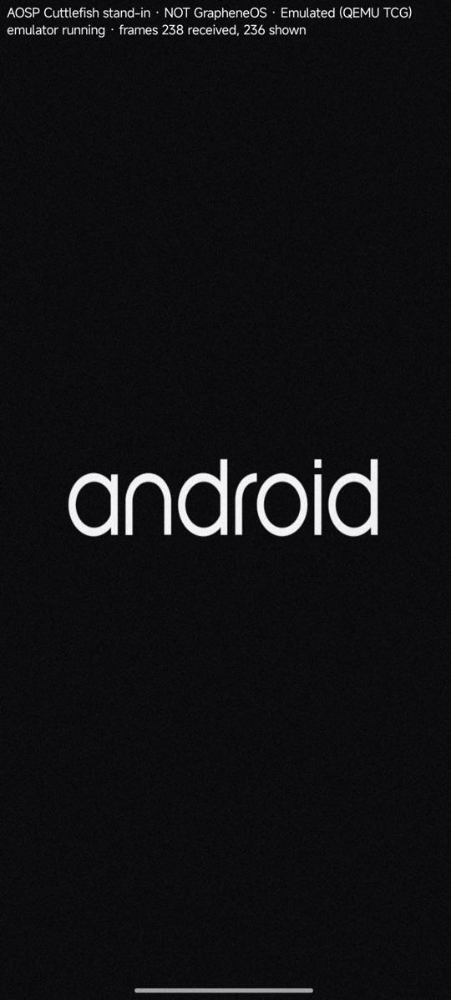

# An Android guest boots on the phone, on screen, in the emulated engine

- **Date:** 2026-11-09
- **Plan:** `docs/superpowers/plans/2026-11-08-qemu-emulated-engine.md`, Phases 4–5
- **Guest:** the **AOSP Cuttlefish stand-in** (`android-standin`, `aosp_cf_arm64_only_phone-userdebug`
  build 16644040, CI run `42641974882`). **This is not GrapheneOS.** It is a Google-built AOSP image
  that the plan sanctions as a stand-in until a GrapheneOS-derived image exists. Nothing here makes a
  GrapheneOS feature, device-identity, attestation or security claim.
- **Phone:** Redmi `kunzite` (Snapdragon 6 Gen 3, Android 16), stock and unrooted, SELinux enforcing.
- **Verdict:** **Android boots and draws on the phone's own screen.** The guest is a real AOSP
  userspace: init, first-stage mount of a GPT `super`, file-based encryption on `/data`, zygote,
  `system_server` and the boot animation, rendered by ANGLE on SwiftShader inside the guest. It ran in
  two ways: as the adb shell user (run 1) and **inside an app, as `untrusted_app`, drawn by the app**
  (run 2). Neither run reached `sys.boot_completed` before it was stopped (see "What this does not
  prove").



*Run 2: the qualification viewer app on the phone, 238 frames received and 236 drawn. The label is
part of the app; the "android" boot animation is the guest's own frame.*

## Runs

| | Run 1 (shell) | Run 2 (app) |
| --- | --- | --- |
| Process | `carbon-frame-probe` + QEMU as `shell` | QEMU forked by `dev.carbonhv.emuviewer`, **`u:r:untrusted_app:s0`**, from a `specialUse` foreground service |
| Frames | 37 saved as PNG via `-display android` | drawn on a `SurfaceView` (238 received, 236 shown) |
| Kernel → `/init` | 4.7 s | 4.9 s |
| `system_server` entered | 6 min 05 s | 4 min 57 s |
| Native crashes (logcat `Fatal signal`) | **326** | **0** |
| Waits for the lights HAL (`Waited one second for …ILights`) | **892**, boot stuck at the animation for 20+ min | **0** |
| Stopped | by me, at 23 min, stuck | by the owner, at 8 min, still booting ("too slow") |
| Evidence (logs gzipped) | `data/20261109-run1-android-standin-shell/` | `data/20261109-run2-android-standin-viewer/` |

Both: `-machine virt,gic-version=3,highmem=on`, TCG with 6 vCPUs, 3 GiB, `-cpu max,pauth-impdef=on`.

## How the guest is assembled (all in the tree)

1. `carbonctl emu boot-assets` (the engine's own `carbon_emu::bootimg`) unpacks `boot`, `init_boot`
   and `vendor_boot` v4 and writes the kernel, the initrd (vendor ramdisk ‖ generic ramdisk ‖
   bootconfig) and the command line. QEMU 11.1.3 has no Android boot-image parser, so this replaces
   U-Boot.
2. `qualification/emu/android-standin/make-disk.py` rebuilds Cuttlefish's `os_composite` GPT disk
   (19 partitions, labels and order from `android_composite_disk_config.cc`). It ships only the
   non-zero 1 MiB runs (1.83 GiB of a 16.3 GiB disk) and a `dd` script that rebuilds the sparse disk
   on the phone. `verify-disk.py` replays that script on the build host and checks both GPT CRCs and
   every partition's sha256 against its source. macOS `diskutil` reads the same table.
3. `bootconfig.txt` holds the 42 keys `assemble_cvd` and Cuttlefish's U-Boot would provide, each with
   its source. The kernel log confirms it was read: `Load bootconfig: 1884 bytes 99 nodes`.
4. The QEMU command line copies Cuttlefish's QEMU launcher (`qemu_manager.cpp`): GPU at slot 2, one
   31-port virtio-serial (hvc0 kernel log, hvc1 Android console, hvc2 logcat), then disk, rng, input,
   balloon and three NICs. The unrooted phone forces the differences: no vsock, no vhost-user input,
   and a direct kernel boot.

## What was wrong, and is fixed

| Finding | Effect | Fix |
| --- | --- | --- |
| `bootconfig_block` wrote `#BOOTCONFIG\n` **before** size/checksum and used a word-sum checksum. Linux reads the magic as the initrd's **last** 12 bytes and checks a byte sum (`init/main.c`, v6.12) | every `androidboot.*` key silently ignored; host tests passed | layout and checksum match the kernel; golden test written from the kernel source; `kernel_view_of_bootconfig` re-reads it the way the kernel does |
| `assemble` parsed vendor_boot's bootconfig section and dropped it | `androidboot.hardware=cutf_cvm` lost | carried ahead of the bootloader keys |
| `vendor_boot` also carries the recovery ramdisk | init would boot recovery | `androidboot.force_normal_boot=1` |
| Thread network HAL aborts: `Check failed: node_id > 0` | crash loop, `sys.init.updatable_crashing` | `androidboot.openthread_node_id=1` (Cuttlefish sets it per instance) |
| Lights HAL binds a vsock server on `ro.boot.vsock_lights_port`, default 0. vsock ports below 1024 need `CAP_NET_BIND_SERVICE`, so EACCES, abort | `system_server` waits for `ILights` forever | `androidboot.vsock_lights_port=6900` (nothing connects; the bind only has to succeed). Run 2: 0 crashes |
| The shell user may not bind a Unix socket in `/data/local/tmp` (SELinux) | QEMU exited at once on `-qmp unix:` | QMP on loopback TCP |
| A frame that arrived before the `SurfaceView` existed was lost until the guest redrew | black screen while booting | the viewer keeps a CPU copy of the latest frame and draws it when a surface attaches; every undrawn frame is logged with the reason |

## Guest adb and console

`adbd` listens on TCP 5555 in the guest (`ro.adb.secure` is unset in this build, so no key is
needed). QEMU forwards `127.0.0.1:6555`/`7555` on the phone to it; from the Mac:
`adb forward tcp:6555 tcp:6555 && adb connect 127.0.0.1:6555`. In run 1 the transport opened, but the
guest's Ethernet had no address yet (configured by `system_server`), so adb stayed `offline`. The
serial console on hvc1 (`adb forward tcp:5560 tcp:5560`, then `nc 127.0.0.1 5560`) answered:

```
console:/ $ id; getprop ro.build.fingerprint
uid=2000(shell) gid=2000(shell) groups=2000(shell),1007(log),3009(readproc) context=u:r:shell:s0
generic/aosp_cf_arm64_only_phone/vsoc_arm64_only:17/CP2A.260605.016/16644040:userdebug/test-keys
```

## What this does not prove

- **No `sys.boot_completed` yet, so no launcher and no usable phone UI.** Under TCG, `system_server`
  needs about 5 minutes and the rest of the boot needs much longer. The owner stopped run 2 as too
  slow. Boot time is the next problem: dex2oat and JIT settings for the emulated profile (plan §8),
  fewer HALs, and gfxstream on the Adreno instead of SwiftShader on emulated CPUs.
- **The viewer app is not the `:vm` service.** It has no broker, no QMP supervision, no fd-passed
  disks and no input. It shows the path works inside the app sandbox, nothing more.
- **Graphics here are guest-CPU rendering** (ANGLE→SwiftShader) over 2D `virtio-gpu-pci`, not the
  gfxstream path the engine is designed around.
- One phone, two runs, one image. No performance claim.

## Reproduce

```bash
gh run download 42641974882 --repo itsrhotaudevvy/carbonhv-guest-android --dir /tmp/standin
export ANDROID_NDK_HOME=~/Library/Android/sdk/ndk/28.2.13676358
B=/tmp/standin/carbonhv-guest-android-standin-16644040
qualification/emu/android-standin/run-on-phone.sh --bundle $B            # shell user, frames to PNG
qualification/emu/android-standin/run-on-phone.sh --bundle $B --viewer   # in the app, on screen
qualification/emu/android-standin/collect.sh [--viewer] --stop           # evidence + stop
```
